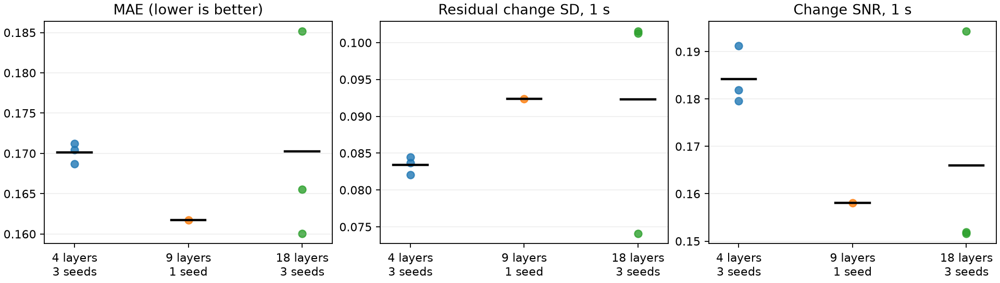
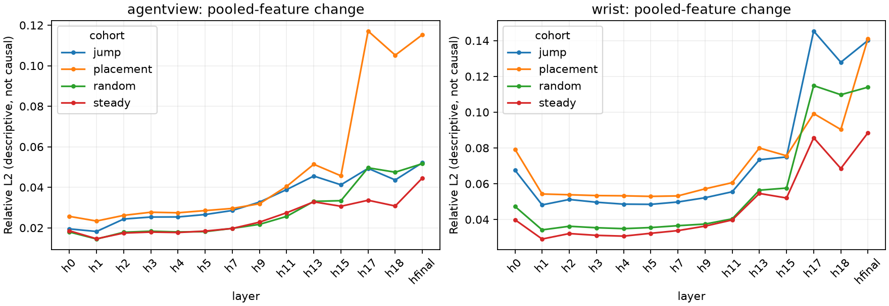

# What causes the value expert's frame-to-frame jumps?

2026-11-05. **CPU audit and pair analysis complete; checkpoint-level GPU interventions not run yet.**
No Slurm job has been submitted by this investigation. The inference runner and its dummy-model correctness
checks are ready. GPU execution awaits capacity under the existing cap or an explicit temporary exception.

## Question

Does the full value expert become unstable because of specific backbone layers, or because of how its learned
expert reads those representations? Can a layer restriction retain accuracy and responses to real progress?

The existing 4/9/18-layer experiment changes both accessible backbone features and the trainable expert's depth.
It is a model comparison, not an isolated intervention on backbone information. The small MLP probes additionally
pool each image to one vector and read one layer, while the expert attends to all prefix tokens layer by layer.

## Setup and reproducibility

- Design: [protocol.md](protocol.md), recorded before selection of diagnostic pairs. All choices are ours;
  between-frame cache substitutions are inspired by activation-patching methods, not a paper reproduction.
- Data: existing fixed+fresh training configuration, evaluated on the same 120 value-validation episodes,
  10 initial scenes, 13,944 frame rows. Episode/frame keys, targets, outcomes, and scenes match across all runs.
  This work uses validation data diagnostically. No policy-test scenes are used.
- Predictions and checkpoint settings: [provenance.json](provenance.json), including prediction SHA-256 hashes,
  original training settings, selected steps, and git HEAD. Diagnostic code is an uncommitted addition to that HEAD.
- Three full-expert seeds: 18237898 / 18237899 / 18237900. Three four-layer seeds:
  18291640 / 18309645 / 18309646. Nine-layer seed 0: 18291639, descriptive only.
- Timing: 20 environment steps/s; cached frames are four steps apart. The historical `change_snr_2s` is
  actually a **1-second** change. Adjacent cached frames are 0.2 s apart.
- CPU scripts: `scripts/libero_layer_diagnosis.py`, `scripts/libero_layer_pair_features.py`.
- Raw selected images remain in `/move/u/karenvo/libero_features/layer_diagnosis_20261105/pairs.npz`.
  They are not embedded in tracked report files or publicly uploaded.

## Observation 1: the previously quoted accuracy trade-off mixes seed counts

| Model | Seeds | Trainable parameters | MAE mean | 1 s residual SD mean | 1 s SNR mean |
|---|---:|---:|---:|---:|---:|
| First 4 layers | 3 | 7.92 M | 0.17011 | 0.08340 | 0.18422 |
| First 9 layers | 1 | 17.75 M | 0.16174 | 0.09239 | 0.15804 |
| All 18 layers | 3 | 35.45 M | 0.17026 | 0.09229 | 0.16595 |

Full-model MAEs are 0.16007 / 0.16557 / 0.18514; four-layer MAEs are
0.16867 / 0.17044 / 0.17121. Full-model seed 2 is actually steadier than four-layer seed 2
(SNR 0.19425 vs 0.19123). The four-layer model is not steadier on every matched seed.

The full-model 0.160 figure is seed 0, not its three-seed mean. Comparing it with the four-layer mean does not
establish a 0.010 MAE penalty for truncation. This does not establish equivalence either.

Uncertainty: 2,000 paired hierarchical bootstrap draws. Resample scenes and then episodes within each drawn
scene, sharing episode weights between models; independently resample training seeds within each model.
Average per-model metrics, not ensemble predictions. Recompute outcome/time means on every draw.

| Four layers minus 18 layers | Estimate | 95% interval |
|---|---:|---:|
| MAE | -0.00015 | [-0.01357, +0.01172] |
| 1 s useful-change signal | +0.00030 | [-0.00161, +0.00243] |
| 1 s residual SD | -0.00889 | [-0.02165, +0.00909] |
| 1 s SNR | +0.01827 | [-0.01988, +0.04996] |
| 0.2 s residual SD | -0.00201 | [-0.00995, +0.01048] |
| 0.2 s SNR | +0.00189 | [-0.01547, +0.01578] |

**Interpretation:** neither the accuracy difference nor the SNR improvement is resolved at this uncertainty
level. Three training seeds and ten scenes are a small basis for generalization. Residual SD includes real
differences in progress and is not an exclusive measurement of prediction error.

The SigLIP-direct MAE 0.215 vs full-expert 0.160 comparison also changes readout and training. The frozen SigLIP
MLP probe already achieved 0.171 with another recipe. These results do not isolate how much accuracy the LM
adds, or establish that the MLP lacks capacity. That remains a controlled-comparison question.

## Observation 2: some large jumps depend strongly on the learned expert

We examined 9,600 adjacent interior pairs from 120 episodes. Of these, 6,802 have no goal-predicate transition
within ten steps of either endpoint and at most 5 mm absolute pot-position movement over the pair. The recorded
goals and object positions follow the action, so both were shifted by one step to align with the observation.
Only `moka_pot_1_pos` / `moka_pot_2_pos` are used for object motion; gripper-relative positions are excluded.

The review set has 12 large jumps selected using full-expert seed 0, 12 low-jump controls matched within the
same episode on time and arm/gripper movement, 12 random eligible pairs, and 12 sustained-placement pairs
selected without looking at predictions. Pair IDs and all models' endpoint predictions are in [pairs.csv](pairs.csv).

Example: episode 530, steps 296 → 300 (0.2 s), zero recorded pot displacement and 26.5 mm arm movement:

| Full expert, same frozen backbone and input frames | Value change |
|---|---:|
| Seed 0 | +0.51705 |
| Seed 1 | -0.01469 |
| Seed 2 | +0.03778 |

Across **all** 9,600 pairs, signed-change correlations between full-model seeds are 0.425 (0/1),
0.313 (0/2), and 0.312 (1/2). Four-layer correlations are 0.503, 0.531, and 0.468.

On the 12 seed-0-selected jumps, mean absolute changes are 0.349 / 0.146 / 0.086 for the three full-model seeds.
Selection favors seed 0, so the reduction on other seeds includes regression to the mean and is not itself a
performance comparison. The example and all-pair correlations show that prediction changes depend strongly
on learned expert weights even with identical backbone features. They do not exclude a backbone contribution.

The no-event filter does **not** establish constant true value: grasp geometry, visibility, arm motion, and
future success probability can change without a goal-predicate transition. These are suspicious pairs, not
new error labels. The contact sheet was inspected by the assistant, not human-validated; no visual labels
were added to training or evaluation.

Descriptive event check across all 97 eligible sustained-placement transitions (94 episodes): the mean signed
0.2 s change is about +0.010 for full models and +0.026 for four-layer models, averaged over seeds. This is an
exploratory instantaneous-event statistic without time-matched adjustment or a confidence interval; it does
not establish a milestone improvement. It gives no evidence that the four-layer model is uniformly sluggish.

## Observation 3: upper-layer feature amplification is not specific to suspicious jumps

For the selected endpoints, read the existing frozen backbone's mean-pooled image features at h0–h18 and
the final norm. Relative L2 is the difference norm divided by the mean endpoint norm, calculated per camera.
This is a descriptive representation metric, not a measure of causal contribution to the value expert.

Examples of mean relative L2, h15 → h17:

| Camera and cohort | h15 | h17 |
|---|---:|---:|
| Wrist, selected jumps | 0.0750 | 0.1454 |
| Wrist, random no-event pairs | 0.0576 | 0.1148 |
| Wrist, steady controls | 0.0520 | 0.0857 |
| Main camera, selected jumps | 0.0412 | 0.0493 |
| Main camera, real placement events | 0.0457 | 0.1171 |

**Interpretation:** later layers amplify wrist-camera changes broadly, and amplify main-camera changes during
real placements. A generic "late layers add noise" explanation is incomplete. The value expert may read useful
and nuisance-sensitive components differently across seeds. The next test targets camera × layer dependence.

Indexing matters: h_l is the input to block l; that block's cached K/V is derived from h_l. The full value expert
reads caches 0–17, so it can read information derived from h0–h17. The h18/final probe's particularly low SNR
does not directly identify a representation consumed by the value expert. h16 was not saved in the probe cache.

## Prepared intervention and validation

`scripts/pi05_layer_interventions.py` uses the existing expert weights and backbone. It substitutes K/V between
the two endpoints at identical layer/position, in both directions, for individual layers, bands 0–3 / 4–8 /
9–15 / 16–17, and camera vs text/state tokens. It also separates K-only from V-only band effects and swaps raw
camera/state inputs, recomputing the backbone. Three full-expert seeds share each diagnostic pair.

- Reproduce each saved endpoint prediction before interpreting effects (absolute V tolerance 0.005).
- Unchanged-cache and full-cache reversal controls must reproduce the corresponding outputs.
- Infer camera order from the observation; never assume token ordering or swap a padding camera.
- Exclude partial text/all-token substitutions when endpoint prefix masks differ. Image positions remain
  aligned. Exclusions are recorded, not silently repaired.
- Keep raw output changes for each direction, metric, seed, and pair. Do not sum effects into an additive
  explanation or normalize by tiny control-pair changes.
- Cache effects identify dependence at a read location. They do not by themselves locate the backbone block
  that originally generated the information; deeper caches can propagate earlier changes.

Validation completed: 204 repository tests passed. A CPU dummy expert passed identity, full reversal with donor
masks, K/V isolation, padding, valid-token sensitivity, and batched seed/patch checks. Actual checkpoint baseline
reproduction and intervention results remain pending. The network-mounted JAX environment stalled during import;
the CPU self-test used a temporary local dependency overlay with JAX 0.5.3 / Flax 0.10.2, leaving existing environments
unchanged. The interactive allocation has 16 GB host RAM, insufficient for the established pi05 loading recipe.

The launch wrapper `scripts/pi05_layer_interventions.sbatch` requests one L40S, 48 GB host RAM, at most two hours.
Launch only within the recorded GPU cap or with an explicit exception. If a reproducible dependence emerges,
the next training experiment should hold expert depth fixed while restricting backbone access.
